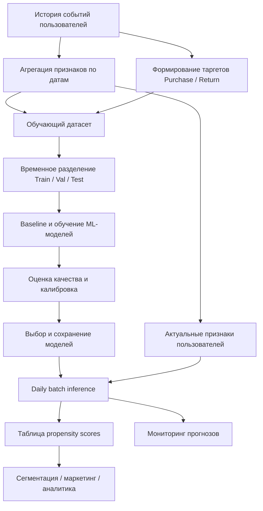

# ML System Design Doc — User Action Propensity Scoring

**Статус:** Draft  
**Тип проекта:** MVP

## 1. Цели и предпосылки

### 1.1. Зачем идем в разработку продукта?

**Бизнес-проблема**

В рамках работ над персонализацией в продукте хотим понимать, какие целевые действия, интересные продукту, пользователь с наибольшей вероятностью совершит в будущем.

Существующие подходы к сегментации пользователей, основанные на историческом поведении и эвристических правилах, не всегда позволяют учитывать сложные закономерности и индивидуальные особенности пользователей.

Разработка универсального механизма прогнозирования целевых действий позволит различным продуктовым направлениям использовать ML-оценки для проверки гипотез персонализации без необходимости разрабатывать отдельную модель для каждого сценария.

**Цель проекта**

Разработать универсальную ML-систему, которая будет регулярно оценивать вероятность совершения пользователями различных целевых действий.

Прогнозы могут использоваться для:

- **Маркетинга:** формирования аудиторий персонализированных кампаний.
- **Продукта:** адаптации интерфейса и пользовательских сценариев.
- **Аналитики:** исследования поведения и построения сегментаций.
- **Поддержки:** определения групп пользователей для релевантных коммуникаций.

**Ожидаемый эффект**

Использование прогнозных оценок должно позволить точнее выделять целевые аудитории и создать основу для более персонализированных продуктовых сценариев.

Например, маркетинг сможет выделять пользователей с высокой вероятностью покупки или, наоборот, пользователей с низкой вероятностью возвращения в продукт.

Успех первой итерации — получение воспроизводимого ML-решения, превосходящего простые эвристические подходы по качеству прогнозирования, и подготовка скоров в формате, пригодном для дальнейшего использования.

Влияние на бизнес-показатели предполагается оценивать отдельно в ходе продуктовых экспериментов.

### 1.2. Бизнес-требования и ограничения

**Функциональные требования**

1. Система должна рассчитывать вероятность совершения нескольких целевых действий. Для MVP выбраны покупка (purchase) и возвращение в продукт (return).
2. Прогнозы должны формироваться для пользователей, удовлетворяющих критериям активности. Предварительно — наличие хотя бы одного события за последние 30 дней.
3. Должны поддерживаться два горизонта прогнозирования: 7 и 14 дней.
4. Скоры должны регулярно обновляться; целевая периодичность — один раз в сутки.
5. Результаты должны быть доступны в структурированном виде для дальнейшей сегментации и аналитики.
6. Архитектура должна допускать добавление новых целевых действий без полной переработки системы. Оптимизация качества отдельных моделей может выполняться после подтверждения полезности соответствующих сценариев.

**Ограничения**

- Предсказания рассчитываются в batch-режиме, без real-time inference
- Для прогнозирования используются только данные, доступные на момент формирования прогноза.
- Для разработки используется открытый датасет с ограниченным периодом наблюдений.
- Доступны только события взаимодействия с товарами. Информация о маркетинговых коммуникациях и других каналах взаимодействия с пользователями отсутствует.
- Система прогнозирует вероятность действия, но не оценивает причинный эффект коммуникаций или продуктовых изменений.
- В рамках MVP не предполагается интеграция с реальными продуктовыми системами.

**Критерии успеха MVP**

- Построен воспроизводимый процесс подготовки обучающих данных и обучения моделей
- Реализован baseline и проведено сравнение с ML-моделью
- Продемонстрировано улучшение качества ранжирования пользователей относительно baseline
- Прогнозы формируются в едином формате и могут использоваться в продукте
- Проверена калибровка предсказанных вероятностей; при необходимости реализована дополнительная калибровка моделей.
- Реализован периодический расчет прогнозов.
- Описаны основные риски, ограничения и подходы к мониторингу моделей

Количественные критерии успеха будут определены после анализа данных и baseline-экспериментов.

### 1.3. Что входит в скоуп проекта/итерации, что не входит

**Входит в MVP:**

- Подготовка исторических признаков поведения пользователей
- Формирование целевых переменных для покупки и возвращения в продукт на горизонтах 7 и 14 дней.
- Обучение и сравнение baseline и ML-моделей.
- Оценка качества прогнозирования на временной тестовой выборке
- Построение batch-пайплайна расчета propensity scores
- Сохранение прогнозов для дальнейшего использования
- Базовый мониторинг качества данных и результатов прогнозирования

**Не входит в MVP:**

- Real-time инференс
- Causal inference
- Автоматический выбор маркетинговых воздействий на основании прогнозов
- Полноценная реализация продуктовой платформы сегментации
- Поддержка неограниченного числа целевых действий
- Production-интеграция с реальными маркетинговыми и продуктовыми системами

### 1.4. Предпосылки решения

**Основные предположения**

- История взаимодействия пользователя с продуктом содержит информацию, полезную для прогнозирования будущих действий
- Для большинства целевых действий задача может быть сформулирована как бинарная классификация
- Поведенческие признаки могут быть сформированы на основании временных окон различной длины
- Для выбранных действий доступна информация о фактах их совершения, необходимая для формирования целевых переменных
- Ежедневного обновления прогнозов достаточно для первоначальных сценариев использования
- Единый процесс подготовки данных и расчета предсказаний может использоваться для нескольких целевых действий.

**Данные и гранулярность**

В качестве источника данных используется открытый датасет [eCommerce Events History in Cosmetics Shop](https://www.kaggle.com/datasets/mkechinov/ecommerce-events-history-in-cosmetics-shop), содержащий историю пользовательских событий интернет-магазина за период с октября 2019 по февраль 2020 года.

Основная единица наблюдения — пользователь на определенную дату (`user_id × prediction_date`).

Датасет содержит следующие виды событий:

- `view` — просмотр товара;
- `cart` — добавление товара в корзину;
- `remove_from_cart` — удаление товара из корзины;
- `purchase` — покупка товара.

Для формирования признаков планируется использовать агрегированную историю активности пользователя, включая количество сессий, просмотры товаров, взаимодействия с корзиной, покупки, категории товаров и стоимость товаров.

Исторические признаки предполагается рассчитывать за окна 7, 30, 60 и 90 дней.

Для MVP прогнозы будут формироваться на начало календарного дня на основании событий, произошедших до этого дня.

Используется идентификатор пользователя `user_id`. Доступный в датасете `user_session` позволяет дополнительно рассчитывать характеристики пользовательских сессий.

Выбор исторических окон и критериев активности пользователей будет уточняться после EDA.

## 2. Методология

### 2.1. Постановка задачи

Задача формулируется как **supervised binary classification**.

Для пользователя \(u\), целевого действия \(a\), даты прогнозирования \(t\) и горизонта \(H\) требуется оценить вероятность:

\[
P(Y_{u,a,t,H}=1 \mid X_{u,t})
\]

где:

- \(X_{u,t}\) — признаки пользователя, известные до начала даты \(t\);
- \(Y_{u,a,t,H}\) — индикатор совершения действия \(a\) в следующие \(H\) дней;
- \(H\) — горизонт прогнозирования (7 или 14 дней).

**Целевые действия первой итерации**

| Действие | Определение таргета | Горизонты |
|---|---|---|
| Purchase | Пользователь совершил хотя бы одну покупку в будущем окне | 7 / 14 дней |
| Return | Пользователь совершил хотя бы одно событие в будущем окне, то есть вернулся в продукт после даты формирования прогноза | 7 / 14 дней |

Целевые события учитываются начиная с даты прогнозирования. События, произошедшие до нее, используются только для формирования признаков.

Для каждого сочетания действия и горизонта предполагается обучать отдельную бинарную модель. Таким образом, в MVP рассматриваются четыре задачи классификации.

В дальнейшем возможно исследование мультитаргетных подходов.

**Популяция прогнозирования**

Предварительно в популяцию включаются пользователи, совершившие хотя бы одно событие за последние 30 дней до даты прогнозирования.

Ограничение позволяет не рассчитывать прогнозы для пользователей, давно не проявлявших активность.

Выбранный критерий должен быть проверен в ходе EDA с точки зрения покрытия будущих целевых действий и числа пользователей, для которых формируются прогнозы.

**Основные группы признаков**

- **Активность:** количество сессий, число активных дней, давность последней активности.
- **Просмотры:** количество просмотров и уникальных просмотренных товаров.
- **История покупок:** число покупок, давность последней покупки, характеристики ранее приобретенных товаров.
- **Взаимодействия с корзиной:** добавления и удаления товаров.
- **Интересы:** категории и бренды товаров, с которыми взаимодействовал пользователь.
- **Динамика поведения:** изменение интенсивности активности относительно предыдущих периодов.

**Обучение моделей**

Для первой итерации предполагается использовать простые эвристические baseline-модели на основе давности и частоты активности пользователя.

В качестве основных ML-моделей рассматриваются алгоритмы градиентного бустинга над табличными данными, например CatBoost или LightGBM.

Выбор окончательного алгоритма будет выполняться на основании результатов экспериментов и вычислительных ограничений.

**Оценка качества**

Предполагается использовать:

- **ROC-AUC** — общее качество ранжирования пользователей.
- **Average Precision (PR-AUC)** — качество ранжирования для редких целевых событий
- **Precision@K и Lift@K** — эффективность выделения наиболее перспективных пользовательских сегментов
- **Log Loss и Brier Score** — качество вероятностных прогнозов.
- **Calibration analysis** — соответствие предсказанных вероятностей фактическим частотам событий

Для оценки на разных этапах используются train, validation и test, разделенные по времени.

При разделении учитываются горизонты целевых переменных, чтобы при обучении не использовалась информация из будущего относительно соответствующего validation/test периода.

Для каждого наблюдения должна быть доступна полная история будущего горизонта. Наблюдения с неполным окном целевого события исключаются из оценки.

Качество моделей сравнивается с baseline на одинаковых тестовых выборках.

### 2.2. Блок-схема решения

**Предлагаемая архитектура MVP**

**Основные этапы решения**

1. Загрузка и первичная проверка исторических событий пользователей.
2. Исследовательский анализ данных и определение популяции прогнозирования.
3. Формирование признаков и целевых переменных.
4. Подготовка обучающих выборок с временным разделением.
5. Разработка baseline и обучение ML-моделей.
6. Оценка качества, калибровка и выбор моделей.
7. Реализация периодического расчета предсказаний.
8. Сохранение прогнозов в едином формате.
9. Мониторинг работы системы и качества результатов.

**Формат выходных данных**

Предполагается формировать таблицу следующего вида:

| Поле | Описание |
|---|---|
| `user_id` | Идентификатор пользователя |
| `prediction_date` | Дата формирования прогноза |
| `target` | Название целевого действия |
| `horizon_days` | Горизонт прогнозирования |
| `score` | Предсказанная вероятность действия |
| `model_version` | Версия модели |

Такая структура позволяет добавлять новые целевые действия и горизонты прогнозирования без изменения формата выходной таблицы.

## 3. Открытые вопросы

- Подходят ли горизонты 7 и 14 дней для обоих целевых действий?
- Какую популяцию пользователей оптимально использовать для расчета скоров?
- Какие исторические окна признаков обеспечивают достаточное качество прогнозирования?
- Какие модели обеспечат приемлемый баланс между качеством и вычислительными затратами?
- Какие количественные критерии качества установить для MVP?
- Как оценивать полезность прогнозов для downstream-сценариев?
- Как организовать переобучение моделей и мониторинг качества с учетом ограниченной истории данных?
