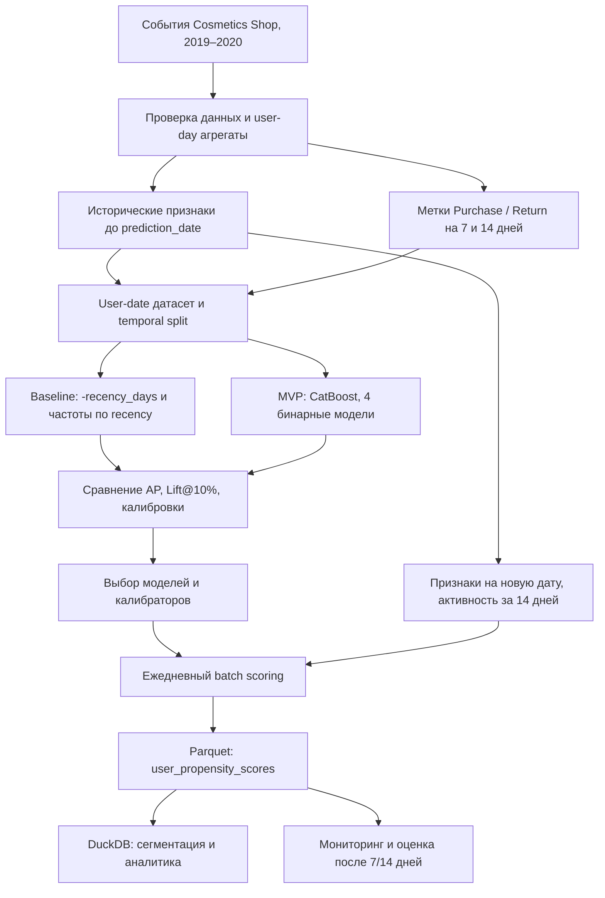
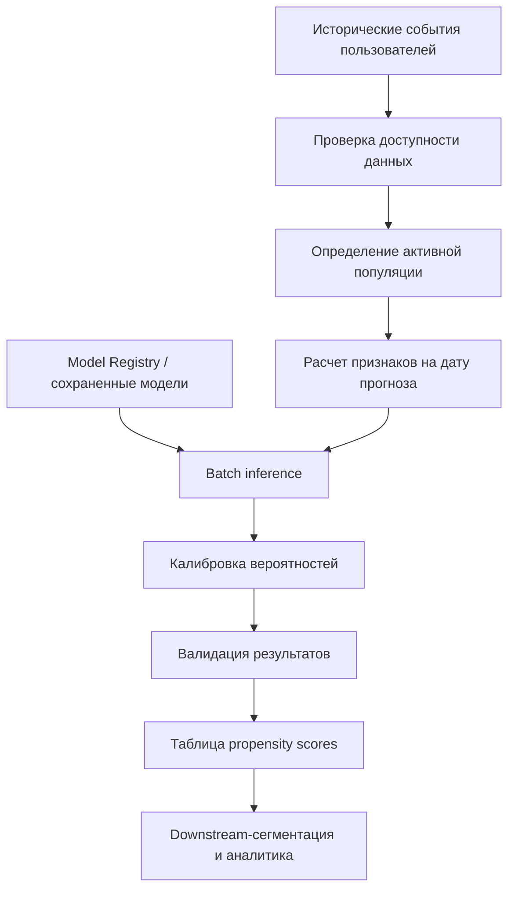

# ML System Design Doc — User Action Propensity Scoring

**Статус:** Draft  
**Тип проекта:** MVP

## 1. Цели и предпосылки

### 1.1. Зачем идем в разработку продукта?

**Бизнес-проблема**

Для персонализации продукта нужно понимать, какие действия пользователь с наибольшей вероятностью совершит в будущем.

Существующие подходы к сегментации пользователей, основанные на историческом поведении и эвристических правилах, не всегда позволяют учитывать сложные закономерности и индивидуальные особенности пользователей.

Общий пайплайн подготовки данных и обучения моделей позволит продуктовым направлениям проверять гипотезы персонализации для разных целевых действий.

**Цель проекта**

Разработать универсальную ML-систему, которая будет регулярно оценивать вероятность совершения пользователями различных целевых действий.

Прогнозы могут использоваться для:

- **Маркетинга:** формирования аудиторий персонализированных кампаний.
- **Продукта:** адаптации интерфейса и пользовательских сценариев.
- **Аналитики:** исследования поведения и построения сегментаций.
- **Поддержки:** определения групп пользователей для релевантных коммуникаций.

**Ожидаемый эффект**

Использование прогнозных оценок должно позволить точнее выделять целевые аудитории и создать основу для более персонализированных продуктовых сценариев.

Например, маркетинг сможет выделять пользователей с высокой вероятностью покупки или, наоборот, пользователей с низкой вероятностью возвращения в продукт.

Успех первой итерации — получение воспроизводимого ML-решения, превосходящего простые эвристические подходы по качеству прогнозирования, и подготовка скоров в формате, пригодном для дальнейшего использования.

Влияние на бизнес-показатели предполагается оценивать отдельно в ходе продуктовых экспериментов.

### 1.2. Бизнес-требования и ограничения

**Функциональные требования**

1. Система должна рассчитывать вероятность совершения нескольких целевых действий. Для MVP выбраны покупка (purchase) и возвращение в продукт (return).
2. Прогнозы должны формироваться для пользователей, удовлетворяющих критериям активности. По результатам EDA для MVP предварительно выбрана активность хотя бы в один из предыдущих 14 календарных дней (по сравнению с первоначально рассматривавшимися 30 днями).
3. Должны поддерживаться два горизонта прогнозирования: 7 и 14 дней.
4. Скоры должны регулярно обновляться. Целевая периодичность — один раз в сутки.
5. Результаты должны быть доступны в структурированном виде для дальнейшей сегментации и аналитики.
6. Архитектура должна допускать добавление новых целевых действий без полной переработки системы. Оптимизация качества отдельных моделей может выполняться после подтверждения полезности соответствующих сценариев.

**Ограничения**

- Предсказания рассчитываются в батч-режиме, без real-time инференса
- Для прогнозирования используются только те данные, что доступны на момент формирования прогноза
- Для разработки используется открытый датасет с ограниченным периодом наблюдений
- Доступны только события взаимодействия с товарами. Информация о маркетинговых коммуникациях и других каналах взаимодействия с пользователями отсутствует.
- Система прогнозирует вероятность действия, но не оценивает причинный эффект коммуникаций или продуктовых изменений.
- В рамках MVP не предполагается интеграция с реальными продуктовыми системами

**Критерии успеха MVP**

- Построен воспроизводимый процесс подготовки обучающих данных и обучения моделей
- Реализован baseline и проведено сравнение с ML-моделью
- Продемонстрировано улучшение качества ранжирования пользователей относительно baseline
- Прогнозы формируются в едином формате и могут использоваться в продукте
- Проверена калибровка предсказанных вероятностей; при необходимости реализована дополнительная калибровка моделей.
- Реализован периодический расчет прогнозов.
- Описаны основные риски, ограничения и подходы к мониторингу моделей

Предварительный ML-критерий успеха — улучшение Average Precision и Lift@10% относительно baseline на отложенном временном тесте без существенного ухудшения калибровки. Минимальный размер улучшения установим после эксперимента с baseline.

### 1.3. Что входит в скоуп проекта/итерации, что не входит

**Входит в MVP:**

- Подготовка исторических признаков поведения пользователей
- Формирование целевых переменных для покупки и возвращения в продукт на горизонтах 7 и 14 дней.
- Обучение и сравнение baseline и ML-моделей.
- Оценка качества прогнозирования на временной тестовой выборке
- Построение batch-пайплайна расчета propensity scores
- Сохранение прогнозов для дальнейшего использования
- Базовый мониторинг качества данных и результатов прогнозирования

**Не входит в MVP:**

- Real-time инференс
- Causal inference
- Автоматический выбор маркетинговых воздействий на основании прогнозов
- Полноценная реализация продуктовой платформы сегментации
- Поддержка неограниченного числа целевых действий
- Production-интеграция с реальными маркетинговыми и продуктовыми системами

### 1.4. Предпосылки решения

**Основные предположения**

- История взаимодействия пользователя с продуктом содержит информацию, полезную для прогнозирования будущих действий
- Для большинства целевых действий задача может быть сформулирована как бинарная классификация
- Поведенческие признаки могут быть сформированы на основании временных окон различной длины
- Для выбранных действий доступна информация о фактах их совершения, необходимая для формирования целевых переменных
- Ежедневного обновления прогнозов достаточно для первоначальных сценариев использования
- Единый процесс подготовки данных и расчета предсказаний может использоваться для нескольких целевых действий.

**Данные и гранулярность**

Используем открытый датасет [eCommerce Events History in Cosmetics Shop](https://www.kaggle.com/datasets/mkechinov/ecommerce-events-history-in-cosmetics-shop) за октябрь 2019 — февраль 2020 года. Он содержит просмотры товаров (`view`), добавления и удаления из корзины (`cart`, `remove_from_cart`), покупки (`purchase`).

Единица наблюдения — `user_id × prediction_date`. Прогноз формируется на начало календарного дня по предшествующей истории пользователя. Поле `user_session` позволяет учитывать характеристики сессий. Состав признаков и исторические окна описаны на этапе подготовки данных.

## 2. Методология

### 2.1. Постановка задачи

Задача формулируется как **supervised binary classification**.

Для пользователя \(u\), целевого действия \(a\), даты прогнозирования \(t\) и горизонта \(H\) требуется оценить вероятность:

\[
P(Y_{u,a,t,H}=1 \mid X_{u,t})
\]

где:

- \(X_{u,t}\) — признаки пользователя, известные до начала даты \(t\);
- \(Y_{u,a,t,H}\) — индикатор совершения действия \(a\) в следующие \(H\) дней;
- \(H\) — горизонт прогнозирования (7 или 14 дней).

**Целевые действия первой итерации**

| Действие | Определение таргета | Горизонты |
|---|---|---|
| Purchase | Пользователь совершил хотя бы одну покупку в будущем окне | 7 / 14 дней |
| Return | Пользователь совершил хотя бы одно событие в будущем окне, то есть вернулся в продукт после даты формирования прогноза | 7 / 14 дней |

Целевые события учитываются начиная с даты прогнозирования. События, произошедшие до нее, используются только для формирования признаков.

Для каждого сочетания действия и горизонта предполагается обучать отдельную бинарную модель. Таким образом, в MVP рассматриваются четыре задачи классификации.

В дальнейшем возможно исследование мультитаргетных подходов.

**Популяция прогнозирования**

По результатам EDA предварительно выбраны пользователи с хотя бы одним событием за предыдущие 14 календарных дней до `prediction_date`. По сравнению с 30-дневной популяцией это примерно вдвое сокращает число пользовательских снимков, сохраняя около 76–82% положительных наблюдений по четырем таргетам.

Выбор популяции потребуется проверить на более частых временных срезах, в том числе для сценариев реактивации.

Признаки описаны на этапе подготовки данных. Baseline на основе recency и CatBoost сравниваются на одинаковых временных выборках; метрики и схема валидации приведены на этапе подготовки моделей.

### 2.2. Блок-схема решения

**Предлагаемая архитектура baseline и основного MVP**



Обе ветки используют одинаковые определения популяции, таргетов и временных разбиений. Работу системы проверим на последовательных исторических датах. Формат прогнозов описан на этапе 4.

### 2.3. Этапы решения задачи

#### Этап 1. Подготовка данных

**1. Источники и состав данных**

Для разработки используется открытый датасет [eCommerce Events History in Cosmetics Shop](https://www.kaggle.com/datasets/mkechinov/ecommerce-events-history-in-cosmetics-shop), содержащий историю пользовательских событий интернет-магазина за октябрь 2019 — февраль 2020 года.

Датасет состоит из пяти CSV-файлов, по одному на календарный месяц. В нем содержится:

- 20,7 млн событий;
- 1,64 млн уникальных пользователей;
- 4,54 млн пользовательских сессий;
- 54,6 тыс. товаров.

Основные поля: `event_time`, `event_type`, `user_id`, `user_session`, `product_id`, `category_id`, `brand`, `price`.

Доступны четыре типа событий: `view`, `cart`, `remove_from_cart`, `purchase`.

Архивные CSV загружаются один раз через `kagglehub`; регулярного поступления новых событий в учебном проекте нет. Ежедневный расчет воспроизводится на исторических данных. Для обработки используется Polars, промежуточные агрегаты сохраняются в Parquet.

Результаты исследования представлены в [EDA-ноутбуке](../notebooks/01_eda_cosmetics.ipynb).

**2. Качество данных и выявленные ограничения**

По результатам EDA:

- Ключевые поля для формирования таргетов заполнены.
- У `user_session` менее 0,1% пропусков.
- `category_code` отсутствует в 98,3% событий, поэтому для категориальных признаков планируется использовать полностью заполненный `category_id`.
- `brand` отсутствует в 42,3% событий.
- В 0,5% событий цена неположительная. Такие значения предполагается исключать из ценовых агрегаций без удаления самих событий.
- Найдено 5,36% полных дубликатов строк, преимущественно среди `remove_from_cart`. Автоматическая дедупликация всех событий не планируется, поскольку одинаковые строки могут соответствовать повторным действиям.

Пользовательская активность разреженная: 76,6% пользователей наблюдались только в один календарный день. Это ограничивает информативность длинных поведенческих историй.

Также выявлена временная неоднородность активности и частоты покупок, особенно в конце декабря.

**3. Формирование обучающих данных**

Основная единица наблюдения — `user_id × prediction_date`.

Для каждой даты прогнозирования используются только события, произошедшие строго до начала этого дня.

Используем предварительно выбранную 14-дневную популяцию из раздела 2.1.

Загрузку данных и подготовку перечисленных ниже сущностей выполняет DS; отдельные DE-ресурсы не требуются.

| Данные / сущность | Источник и формат | Кто / как получает | Проверка качества                                                |
|---|---|---|------------------------------------------------------------------|
| Raw events | Kaggle, 5 месячных CSV | DS, автоматическая загрузка `kagglehub` | Проведена в EDA: пропуски, цены, дубликаты                       |
| User-day aggregates | Агрегация raw events, Parquet | DS / Polars | Проверены объем и структура, используется в EDA                  |
| Feature dataset | `user_id × prediction_date`, исторические события до даты прогноза | Планируется DS / Polars | Point-in-time контроль и проверки схемы — на этапе реализации    |
| Target dataset | `user_id × prediction_date`, `purchase` / `return` на 7/14 дней | DS / Polars | Инварианты на 3 млн снимков и сверка 500 строк — выполнены в EDA |
| Predictions | Четыре скора на пользователя и дату, Parquet | Планируется batch inference | Проверки уникальности, полноты и диапазона [0, 1] — в MVP        |

**Основные группы признаков:**

- Recency — давность последней активности и целевых действий.
- Frequency — количество сессий, просмотров, действий с корзиной и покупок.
- Engagement — количество активных дней, уникальных товаров и категорий.
- Trends — изменение интенсивности поведения между историческими периодами.
- Context — доступные характеристики товаров и календарные признаки.

Для формирования признаков рассматриваются исторические окна 7, 30, 60 и 90 дней. Примеры: `events_7d`, `sessions_7d`, `active_days_30d`, `views_30d`, `carts_30d`, `purchases_30d`, `unique_products_30d`, `recency_days`, `days_since_last_purchase`. Исторические агрегаты должны учитывать только события до `prediction_date`.

90-дневные окна не полностью наблюдаемы для ранних срезов: будут использоваться признаки доступной длины истории (`observed_history_days`, индикатор неполного окна), либо соответствующие срезы исключаться в сравнительном эксперименте. Для отсутствующих событий используется ноль в счетчиках, для неизвестных интервалов с последней покупкой — отдельный sentinel/индикатор отсутствия истории; значения не подменяются средними.

**Целевые переменные:**

- `purchase_7d`, `purchase_14d` — наличие хотя бы одного события покупки в соответствующем будущем окне.
- `return_7d`, `return_14d` — наличие хотя бы одного пользовательского события в соответствующем будущем окне.

На дату `t` историческое окно — `[t−W, t)`, а будущее окно целевой переменной — `[t, t+H)` по календарным дням. `return` означает **любое событие после начала даты прогнозирования**, в том числе `purchase`; это операционное определение возврата, не обязательно отдельная новая сессия.

Для каждого наблюдения необходимо обеспечить полноту будущего окна. Срезы с неполной историей целевых событий исключаются из обучающей и оценочной выборок. При последней дате исходных событий 2020-02-29 последний допустимый срез для 14-дневного таргета — 2020-02-16 (события до 2020-02-29 включительно).

В EDA проведены проверки логической согласованности таргетов на 3 млн пользовательских снимков и независимый пересчет на выборке из 500 наблюдений. Нарушений не выявлено.

**4. Достаточность данных**

В предварительном EDA для 14-дневной популяции получены следующие target rates:

| Таргет | Target rate |
|---|---:|
| Purchase 7d | 1,47% |
| Purchase 14d | 2,51% |
| Return 7d | 11,57% |
| Return 14d | 16,31% |

Количество положительных наблюдений позволяет рассматривать обучение отдельных бинарных моделей для каждого таргета.

Дополнительный сбор данных для учебного MVP не планируется. При этом перед моделированием необходимо уточнить объем положительных примеров непосредственно в train, validation и test.

**5. Конфиденциальность**

В датасете отсутствуют явные персональные поля, такие как имена или контактные данные. Однако пользовательские идентификаторы и последовательности действий могут представлять риск повторной идентификации при сопоставлении с внешними источниками.

Исходные события не планируется публиковать в репозитории. Для воспроизведения экспериментов предоставляются ссылка на открытый датасет и код его загрузки.

**6. Риски и способы их снижения**

| Риск | Предполагаемое решение |
|---|---|
| Разреженная история пользователей | Использование recency/frequency-признаков и отдельных признаков отсутствия истории |
| Дисбаланс классов, особенно Purchase | PR-AUC, Precision@K, Lift@K, контроль числа позитивных примеров |
| Временная неоднородность | Temporal validation и анализ качества по периодам |
| Утечка будущей информации | Point-in-time формирование признаков, контроль границ окон |
| Корреляция ежедневных снимков | Временное разделение и возможное сэмплирование дат обучения |
| Неполная история в начале периода | Контроль доступной длины истории и признаков неполного окна |
| Ограниченный период наблюдений | Проверка устойчивости результатов на нескольких временных интервалах |

**7. Результат этапа**

На выходе ожидаются:

- Воспроизводимый процесс загрузки и подготовки исходных данных.
- Таблица исторических признаков на уровне `user_id × prediction_date`.
- Таблица целевых переменных для двух действий и двух горизонтов.
- Проверки качества данных, корректности временных границ и целевых переменных.
- Подготовленные данные для обучения и временной валидации моделей.

#### Этап 2. Подготовка прогнозных моделей

**1. Постановка задачи моделирования**

Обучаем четыре бинарные модели для таргетов, определенных в разделе 2.1. Каждая получает исторические признаки пользователя и возвращает вероятность действия на соответствующем горизонте.

**2. ML-метрики и функции потерь**

| Метрика | Назначение |
|---|---|
| ROC-AUC | Оценка способности модели ранжировать пользователей |
| Average Precision (AP) | Оценка качества ранжирования при дисбалансе классов |
| Precision@K, Lift@K | Оценка качества отбора пользователей для целевых аудиторий |
| Brier Score, Log Loss | Оценка качества вероятностных прогнозов |
| Calibration curve | Проверка соответствия предсказанных вероятностей фактическим частотам событий |

**Основные метрики — Average Precision и Lift@K; основная операционная точка для MVP — Lift@10% (дополнительно Lift@5%).**

Покупка — редкое событие: target rate для `purchase_7d` составляет 1,47%. Поэтому используем AP для оценки ранжирования и Lift@K для оценки отбора аудитории относительно случайного выбора. Начальные размеры аудитории — верхние 5% и 10% пользователей по скору; позднее их уточним под продуктовый сценарий. Качество вероятностей проверяем через Brier Score, Log Loss и calibration curves.

Функция потерь — **Binary Cross-Entropy (Log Loss)**: она подходит для бинарных таргетов и обучения вероятностных прогнозов, сильнее штрафуя уверенные ошибочные предсказания.

Качество моделей оценивается отдельно для каждого таргета и горизонта. Сравнение значений AP между задачами с различной частотой положительного класса требует осторожности. Для сценариев реактивации приоритет ранжирования может быть противоположным — низкий score; прогноз склонности к действию сам по себе не является оценкой uplift от коммуникации.

**3. Схема ML-валидации**

Используем хронологическое разделение: train для обучения и статистик предобработки, validation для выбора модели и гиперпараметров, calibration для отдельной калибровки, test для финальной оценки.

Один пользователь может встречаться в разных периодах, что соответствует ежедневному пересчету прогнозов. Случайное разбиение смешало бы прошлые и будущие наблюдения и скрыло временные изменения активности.

Признаки рассчитываются строго до даты прогноза. К началу следующего оценочного периода целевые окна обучающих наблюдений должны полностью завершиться. Для горизонта 14 дней это означает условие `t + 14 дней ≤ T`, где `t` — дата обучающего снимка, `T` — первый день оценки.

**Предварительный пример границ (для максимального горизонта 14 дней):**

| Набор | `prediction_date` | Использование |
|---|---|---|
| Train | 2019-11-01 — 2019-12-17 | Обучение модели и статистик baseline |
| Validation | 2020-01-01 — 2020-01-10 | Выбор модели и гиперпараметров |
| Calibration | 2020-01-11 — 2020-01-17 | Отдельная калибровка при необходимости |
| Test | 2020-02-01 — 2020-02-15 | Однократная финальная оценка |

Прогнозы для calibration рассчитываем задним числом выбранной на validation моделью, а калибратор обучаем до начала test.

Границы примерные и будут уточняться перед моделированием. На момент первого прогноза test все выбранные для обучения и калибровки метки уже полностью наблюдаемы. Train не использует события из validation и test для формирования таргетов. Для честной оценки полезно повторить эксперимент со сдвигом временных границ (walk-forward), если позволяет объем данных.

Для baseline и CatBoost используются **одни и те же** train/validation/calibration/test и популяция. Калибратор не обучается на test; при подборе модели и калибровки избегаем повторного использования тех же целевых меток без независимой проверки.

**4. Baseline**

В качестве основного baseline предлагается использовать давность последней пользовательской активности — `recency_days`.

По результатам EDA обнаружена выраженная монотонная связь между recency и частотой будущих целевых действий.

Например, для `purchase_7d` target rate снижается с 4,66% среди пользователей, активных за день до прогноза, до 0,33% при recency 15–30 дней.

**Baseline 1 — Recency-based ranking**

Пользователи ранжируются по давности последней активности: чем меньше recency, тем выше скор.

Такой baseline не требует обучения и позволяет оценить качество простого поведенческого правила.

**Baseline 2 — Empirical propensity**

Для каждой группы recency рассчитывается частота целевого действия на обучающей выборке.

Полученная историческая частота используется как вероятностный прогноз для пользователей соответствующей группы.

Границы групп и вероятности определяются только по train. Для групп с небольшим числом наблюдений может использоваться сглаживание оценок.

Оба baseline оцениваются на тех же validation/test периодах и популяции, что и основные ML-модели.

**5. Основные модели и предобработка**

В качестве основного подхода рассматривается градиентный бустинг над табличными данными.

Первым кандидатом выбран **CatBoost**, поскольку он подходит для табличных данных, поддерживает категориальные признаки и позволяет работать с пропущенными значениями числовых признаков.

В качестве альтернативы рассматривается LightGBM.

Используем группы признаков, описанные на этапе 1.

Предобработка должна включать обработку пропусков, некорректных ценовых значений и возможных повторных событий.

Числовые и категориальные преобразования определяются на обучающей выборке и затем одинаково применяются при validation, test и inference.

Масштабирование числовых признаков для CatBoost не является обязательным.

**6. Стратегия развития моделей**

Усложняем модель поэтапно, проверяя прирост качества на временной валидации:

1. Реализовать оба baseline на основе recency.
2. Обучить первую CatBoost-модель на базовых поведенческих признаках.
3. Сравнить качество относительно baseline на одинаковой временной выборке.
4. Добавить признаки, отражающие историю покупок, взаимодействия с корзиной и динамику активности.
5. Исследовать влияние различных исторических окон.
6. При необходимости провести оптимизацию гиперпараметров.
7. Оценить качество калибровки и применить дополнительную калибровку, если она улучшает результаты на независимых данных.

Из-за редкости покупок отдельно планируется исследовать качество моделей для пользователей с различной давностью последней активности и насыщенностью истории.

В случае недостаточного качества отдельных моделей может рассматриваться изменение горизонта прогнозирования, набора признаков или целевой популяции.

**7. Анализ и интерпретация моделей**

Для интерпретации планируется использовать:

- Feature importance — оценку наиболее значимых признаков.
- SHAP — анализ влияния отдельных признаков на предсказания.
- Анализ качества по группам recency и пользовательской активности.
- Анализ ошибок модели: false positive и false negative.
- Проверку распределения предсказаний и калибровки на разных временных периодах.

Особое внимание необходимо уделять тому, насколько модель использует дополнительную поведенческую информацию по сравнению с recency-based baseline.

**8. Риски и способы их снижения**

| Риск | Способ снижения |
|---|---|
| Дисбаланс классов | AP, Lift@K, контроль качества в верхних сегментах скоринга |
| Переобучение | Temporal validation, регуляризация, ограничение сложности моделей |
| Временная нестабильность | Оценка по периодам и контроль калибровки |
| Утечка будущей информации | Point-in-time признаки и контроль целевых окон |
| Корреляция соседних снимков | Разделение по времени, анализ схемы сэмплирования |
| Некорректная калибровка | Brier Score, calibration curves, отдельная калибровочная выборка |
| Разреженная история | Recency/frequency-признаки, обработка отсутствующей истории |
| Высокие вычислительные затраты | Ограничение популяции, сэмплирование обучающих снимков, поэтапный FE |

**9. Результат этапа**

На выходе ожидаются:

- Реализованные baseline-модели для всех четырех задач.
- Обученные ML-модели и зафиксированные конфигурации обучения.
- Воспроизводимая схема временной валидации.
- Сравнение baseline и ML-моделей по выбранным метрикам.
- Анализ калибровки и интерпретация предсказаний.
- Сохраненные версии моделей и параметры предобработки, пригодные для batch inference.


#### Этап 3. Batch inference

**1. Цель этапа**

Реализовать ежедневный расчет четырех скоров с возможностью повторного запуска на заданную историческую дату и независимого обновления моделей.

**2. Схема расчета прогнозов**

Inference предполагается выполнять один раз в сутки на начало календарного дня.

Для каждой даты `prediction_date` процесс включает следующие шаги:

1. Проверка доступности и полноты исходных событий за предыдущий день.
2. Формирование популяции пользователей, активных за последние 14 дней.
3. Расчет исторических признаков на основании событий до `prediction_date`.
4. Применение сохраненных преобразований и моделей.
5. Расчет и, при необходимости, калибровка вероятностей для каждого таргета.
6. Проверка качества сформированных прогнозов.
7. Сохранение результатов для последующего использования.

В учебной реализации пайплайн будет воспроизводиться на последовательных датах исторического датасета.

**3. Архитектура inference**



**4. Требования к inference**

Расчет выполняется в batch-режиме для пользователей с активностью за предыдущие 14 дней. Новые модели должны подключаться без изменения общей логики расчета и сохранения прогнозов.

**5. Обработка ошибок и повторные запуски**

Для повышения надежности предполагается предусмотреть:

- Проверку наличия необходимых исходных данных перед запуском.
- Контроль схемы и заполненности ключевых признаков.
- Прерывание расчета при критических ошибках подготовки данных.
- Идемпотентное сохранение: повторный запуск для одной даты не должен создавать дубликаты прогнозов.
- Логирование количества обработанных пользователей, времени выполнения и ошибок.
- Сохранение идентификаторов версий моделей, использованных при расчете.

При отсутствии необходимых данных расчет завершается с ошибкой.

**6. Производительность и масштабирование**

Размер ежедневной популяции существенно меньше 1,64 млн пользователей за весь период. Начнем с локальной пакетной обработки; время расчета и потребление памяти измерим на прототипе. При росте нагрузки рассмотрим ограничение размера batch, инкрементальный расчет признаков, распределенную обработку и параллельный запуск моделей.

**7. Риски и способы их снижения**

| Риск                                            | Способ снижения                                              |
|-------------------------------------------------|--------------------------------------------------------------|
| Неполные или отсутствующие данные               | Проверки полноты перед расчетом                              |
| Несовпадение признаков при обучении и inference | Единый код feature engineering и сохраненная схема признаков |
| Использование неподходящей версии модели        | Явное версионирование моделей и конфигураций                 |
| Дубликаты прогнозов при повторном запуске       | Идемпотентная запись результатов                             |
| Увеличение времени расчета                      | Batch-обработка, профилирование, инкрементальные признаки    |
| Устаревшие прогнозы                             | Контроль даты последнего успешного расчета                   |

**8. Результат этапа**

На выходе ожидаются:

- Воспроизводимый batch-пайплайн расчета прогнозов на заданную дату.
- Возможность последовательного запуска inference для исторических дат.
- Прогнозы для всех четырех сочетаний целевого действия и горизонта.
- Проверки корректности и полноты выходных данных.
- Логи выполнения и информация об использованных версиях моделей.


#### Этап 4. Хранение и использование прогнозов

**1. Цель этапа**

Сохранять актуальные прогнозы и историю расчетов для сегментации пользователей и аналитики.

**2. Формат и структура хранения**

Прогнозы храним в Parquet, аналитические SQL-запросы выполняем через DuckDB. Производительность проверим на прототипе.

Основная таблица — `user_propensity_scores`.

Гранулярность: `user_id × prediction_date × target × horizon_days`.

| Поле | Тип | Описание                                          |
|---|---|---------------------------------------------------|
| `user_id` | String | Идентификатор пользователя                        |
| `prediction_date` | Date | Дата формирования прогноза                        |
| `target` | String | `purchase` или `return`                           |
| `horizon_days` | Integer | Горизонт прогноза: 7 или 14 дней                  |
| `score` | Float | Прогнозируемая вероятность от 0 до 1              |
| `model_version` | String | Версия использованной модели                      |
| `scored_at` | Timestamp | Фактическое время расчета                         |
| `pipeline_version` | String | Версия пайплайна подготовки признаков и inference |

Пример записи:

```json
{
  "user_id": "123456",
  "prediction_date": "2020-02-10",
  "target": "purchase",
  "horizon_days": 7,
  "score": 0.034,
  "model_version": "purchase_7d_v1",
  "scored_at": "2020-02-10T02:00:00Z",
  "pipeline_version": "v1"
}
```

В этом условном примере `score = 0.034` означает вероятность покупки 3,4% в следующие 7 дней. Соответствие скоров фактической частоте покупок проверяем при оценке калибровки.

**3. Организация хранения и обновления**

Результаты предполагается хранить с партиционированием по `prediction_date`.

Пример структуры:

```text
data/
└── predictions/
    ├── prediction_date=2020-02-08/
    │   └── scores.parquet
    ├── prediction_date=2020-02-09/
    │   └── scores.parquet
    └── prediction_date=2020-02-10/
        └── scores.parquet
```

Для каждой даты формируется полный набор прогнозов для соответствующей популяции и всех четырех сочетаний таргета и горизонта.

Повторный запуск inference должен обеспечивать идемпотентность: новая партиция записывается во временное место, проходит проверки и только затем заменяет опубликованную версию без накопления дублирующихся записей. На локальной файловой системе публикация может использовать атомарное переименование в пределах одного тома.

При этом необходимо сохранять информацию об использованных версиях моделей и пайплайна.

Исторические прогнозы не должны изменяться при обычном обновлении моделей. Повторный расчет за прошлую дату рассматривается как отдельная операция backfill.

**4. Проверки качества выходных данных**

Перед публикацией новой партиции необходимо проверить:

- Уникальность комбинации `user_id × prediction_date × target × horizon_days`.
- Отсутствие пропусков в ключевых полях.
- Отсутствие `NaN`, бесконечных значений и вероятностей вне диапазона [0, 1].
- Наличие ожидаемых четырех прогнозов на пользователя.
- Соответствие даты прогноза запрошенной `prediction_date`; фактическое время расчета сохраняется в `scored_at`.
- Соответствие моделей используемым таргетам и горизонтам.
- Отсутствие необъяснимых изменений количества пользователей относительно предыдущих запусков.

Новая партиция становится доступной потребителям только после успешного прохождения проверок.

**5. Использование результатов**

Прогнозы используются для отбора аудиторий, персонализации и анализа пользовательских сегментов. Продуктовый эффект выбранных коммуникаций оценивается отдельным экспериментом.

Пример аналитического запроса — выбор 10% пользователей с наибольшей прогнозируемой вероятностью покупки:

```sql
WITH ranked AS (
    SELECT
        user_id,
        score,
        NTILE(10) OVER (ORDER BY score DESC, user_id) AS score_decile
    FROM user_propensity_scores
    WHERE prediction_date = DATE '2020-02-10'
      AND target = 'purchase'
      AND horizon_days = 7
)
SELECT
    user_id,
    score
FROM ranked
WHERE score_decile = 1;
```

**6. Ограничения и развитие решения**

Локальные Parquet-файлы и DuckDB подходят для учебного MVP. При переходе к многопользовательскому доступу потребуется централизованное хранилище с разграничением прав и управлением версиями прогнозов.

**7. Результат этапа**

На выходе ожидаются:

- Таблица `user_propensity_scores` с историей прогнозов.
- Партиционированное хранение по датам.
- Проверки корректности и полноты результатов inference.
- Возможность повторного расчета прогнозов за заданную дату.
- SQL-интерфейс для анализа прогнозов и формирования пользовательских сегментов.


#### Этап 5. Мониторинг и переобучение моделей

**1. Цель этапа**

Выявлять сбои пайплайна, изменения данных и снижение качества прогнозов; поддерживать обновление моделей и откат к предыдущей версии.

**2. Что и когда проверяем**

| Объект | Показатели | Периодичность |
|---|---|---|
| Batch-пайплайн | Статус и длительность запуска, число пользователей и прогнозов, дата последнего успешного расчета, версии моделей и пайплайна | После каждого запуска |
| Входные данные | Доли пропусков, размер популяции, распределения recency, активных дней, сессий и покупок, доля пользователей с неполными признаками | Ежедневно |
| Прогнозы | Распределение и среднее значение скоров, доли пользователей по диапазонам вероятности | Ежедневно, отдельно по каждой модели |
| Качество моделей | AP, ROC-AUC, Precision@K, Lift@K, Brier Score, Log Loss, calibration curves и target rate | Еженедельно, по полностью наблюдаемым целевым окнам |

Метрики качества считаются отдельно для каждого таргета и горизонта, в том числе по группам recency и интенсивности активности. Для оценки нужно дождаться завершения 7- или 14-дневного окна. Сравнение с recency-baseline показывает, сохраняется ли преимущество ML-модели.

Распределения признаков и скоров сравниваются с train и предыдущими периодами. Для этого можно использовать PSI, Jensen–Shannon divergence и описательные статистики. Пороги предупреждений определим по истории запусков с учетом естественной вариативности: EDA уже показал заметные изменения активности и target rate во времени.

**3. Реакция на проблемы и риски**

| Риск или сигнал | Действие |
|---|---|
| Отсутствие данных, нарушение схемы признаков | Остановить публикацию новых прогнозов, сохранить ошибку в логах |
| Рост пропусков или сдвиг распределений | Проверить источник данных и изменения состава аудитории |
| Устойчивое снижение AP / Lift@K относительно baseline и временной валидации | Проверить качество по периодам и сегментам, рассмотреть переобучение |
| Ухудшение калибровки | Проверить target rate, Brier Score и calibration curves; оценить новую калибровку |
| Ложные сигналы деградации | Учитывать объем выборки, динамику нескольких показателей и естественные колебания |
| Задержка целевых меток | Оценивать только прогнозы с завершенным целевым окном |
| Неудачное обновление модели | Сравнить версии до публикации, предусмотреть откат |

Решение о переобучении принимается по устойчивой динамике нескольких показателей. Одного отклонения для замены модели недостаточно.

**4. Переобучение и откат**

Начальный ориентир — ежемесячное переобучение с возможностью внепланового запуска при устойчивом ухудшении качества. Частоту уточним по результатам backtesting.

Порядок обновления:

1. Подготовить новые данные с полностью наблюдаемыми таргетами, пересчитать признаки и проверить их качество.
2. Обучить новую модель и оценить ее на более позднем validation-периоде.
3. Сравнить с текущей моделью и baseline, проверить калибровку и качество по сегментам.
4. Зарегистрировать новую версию и подключить к inference при выполнении критериев качества.

Для каждой версии сохраняются периоды обучения и оценки, схема признаков, конфигурация обучения и предобработки, параметры калибровки, метрики на использованных оценочных выборках и дата подключения к inference. При критическом ухудшении качества возвращаем предыдущую проверенную версию. При обновлении модели уже опубликованные исторические прогнозы остаются без изменений.

**5. Проверка в учебном проекте**

Пять месяцев исходных данных позволяют проверить процесс на исторических срезах: последовательно рассчитать прогнозы, дождаться целевых меток в рамках replay, построить динамику качества и распределений, сравнить версии моделей. Для оценки надежности в production потребуется наблюдение на новых данных после запуска.

**6. Результат этапа**

Логи batch-запусков, отчет или дашборд с динамикой данных и качества моделей, воспроизводимая процедура переобучения, сравнения версий и отката.

## 3. Открытые вопросы

- Какой фактический прирост AP и Lift@10% дают ML-модели относительно baseline на независимом test?
- Устойчив ли выбор 14-дневной популяции при ежедневных снимках и в сценариях реактивации?
- Улучшают ли 60 / 90-дневные окна признаки с учетом неполной истории в начале датасета?
- Какие границы временных выборок оптимальны при ограниченной истории наблюдений?
- Какой объем вычислений и длительность локального batch inference будут измерены в прототипе?
- Какие критерии деградации и периодичность переобучения обоснует исторический backtesting?
- Какую добавочную бизнес-ценность дадут сегменты по результатам продуктового эксперимента?
